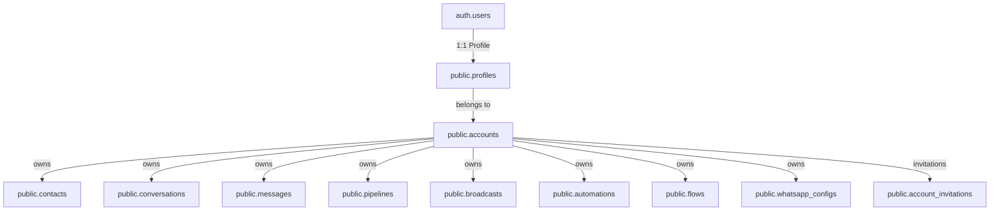
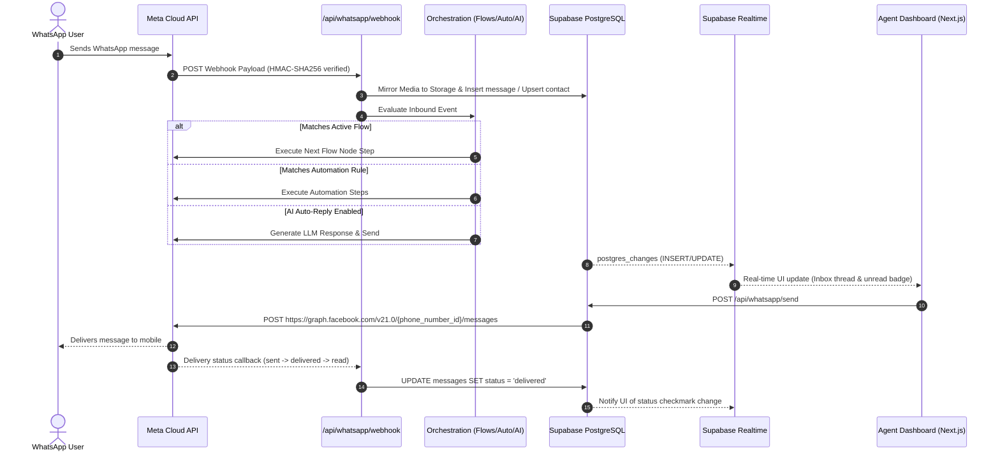

# WACRM System Architecture, Data Models & Component Hierarchy

## 1. Executive Summary & Tech Stack

**WACRM** is an enterprise-grade, self-hostable Customer Relationship Management (CRM) platform specifically architected for the **WhatsApp Business Cloud API**, built using **Next.js (App Router)** and **Supabase (PostgreSQL + Realtime + Storage + Auth)**.

### Technology Stack Overview

| Layer | Technologies Used | Primary Responsibilities |
|---|---|---|
| **Framework / Runtime** | Next.js 16 (App Router), React 19, TypeScript | Server Components, Client Components, Route Handlers, Edge & Node runtimes |
| **Database & Auth** | Supabase (PostgreSQL 15+), Supabase SSR, Supabase Auth | Relational schema, Row-Level Security (RLS), DB Triggers, Stored Procedures (RPCs), Session Auth |
| **Realtime Engine** | Supabase Realtime (WebSocket `postgres_changes`) | Instant inbox syncing, typing indicators, presence tracking, notification alerts |
| **Blob / Object Storage**| Supabase Storage (`chat-media`, `profile-avatars`, `flow-media`) | Media handling (voice notes, documents, images, videos) |
| **External Integration**| Meta Graph API v21.0+ (WhatsApp Cloud API) | Inbound webhooks, outbound message dispatch, template management, WABA sync |
| **Styling & UI** | Tailwind CSS v4, Lucide React, Radix / Base UI, Sonner, Recharts, @xyflow/react | Responsive layouts, charts, toast notifications, visual flow diagramming |
| **Internationalization**| `next-intl` | Multi-language UI routing and translated strings |

---

## 2. Global Architecture & Tenancy Model

### 2.1 Multi-Tenant Account Architecture
Tenancy in WACRM is strictly isolated through the `account_id` foreign key and PostgreSQL **Row Level Security (RLS)**.



### 2.2 Roles & RBAC (`src/lib/auth/roles.ts` and `src/lib/auth/account.ts`)
The application defines four progressive privilege tiers:

```typescript
export type AccountRole = 'owner' | 'admin' | 'agent' | 'viewer';
```

- **`owner` (Rank 4):** Account creation, billing/danger zone, member ownership transfer, destructive actions.
- **`admin` (Rank 3):** Team invitations, role changes, API keys, webhook configs, WhatsApp WABA connection.
- **`agent` (Rank 2):** Read/write access to Inbox, sending messages, managing contacts, deals, notes, and triggers.
- **`viewer` (Rank 1):** Read-only view of conversations, dashboard, contacts, and reports. Blocked from sending outbound messages.

#### Role Enforcement in Backend:
```typescript
// Backend route protection helper:
const { supabase, accountId, userId, role } = await requireRole('agent');
```

---

## 3. High-Level Inbound & Outbound Communication Pipeline



---

## 4. Complete Module Hierarchy & Code Breakdown

Below is the exhaustive architectural breakdown of each subsystem: Data Model (Schema), Backend Handlers / Classes, UI Components, and Hooks.

---

### Module 1: Dashboard

The Dashboard provides real-time high-level operational intelligence: conversation velocity, agent response times, deal pipeline distribution, and live activity streams.

```
📁 src/
├── 📁 app/(dashboard)/dashboard/
│   └── page.tsx                     # Main Dashboard Client Component
├── 📁 lib/dashboard/
│   ├── queries.ts                   # Database aggregation queries (loadMetrics, loadConversationsSeries, etc.)
│   ├── types.ts                     # TypeScript metrics & analytics definitions
│   └── date-utils.ts                # Timezone & date-range bucketing utilities
└── 📁 components/dashboard/
    ├── metric-card.tsx              # KPI Card (Count, Delta, Icon, Tooltip)
    ├── conversations-chart.tsx      # Inbound vs Outbound message velocity chart (Recharts)
    ├── pipeline-donut.tsx           # Deal pipeline distribution donut
    ├── response-time-chart.tsx      # First response time & resolution distribution
    ├── activity-feed.tsx            # Live chronological audit log feed
    ├── quick-actions.tsx            # Quick launch shortcuts (Send Broadcast, Add Contact, etc.)
    └── skeleton.tsx                 # Loading state skeleton cards
```

#### Key Models & Code Reference:
```typescript
// src/lib/dashboard/types.ts
export interface MetricsBundle {
  openConversations: number;
  openConversationsChange: number;
  newContactsToday: number;
  newContactsChange: number;
  openDealsValue: number;
  openDealsCount: number;
  messagesSentToday: number;
  messagesSentChange: number;
}

export interface ActivityItem {
  id: string;
  type: 'message' | 'contact' | 'deal' | 'broadcast';
  title: string;
  subtitle?: string;
  timestamp: string;
  metadata?: Record<string, unknown>;
}
```

#### Backend Aggregation Layer:
- **`loadMetrics(db)`**: Aggregates counts across `conversations`, `contacts`, `deals`, and `messages`.
- **`loadConversationsSeries(db, rangeDays)`**: Buckets incoming vs outgoing message volume grouped by day.
- **`loadPipelineDonut(db)`**: Calculates deal value and counts per stage in `pipeline_stages`.
- **`loadResponseTime(db)`**: Analyzes the elapsed time between customer inbound and first agent response.

---

### Module 2: Inbox & Messaging (Team Inbox)

The Inbox is the core operational communication hub. It features multi-agent thread management, conversation assignment, live typing, media attachments, template pickers, interactive buttons/lists, and contact sidebar details.

```
📁 src/
├── 📁 app/(dashboard)/inbox/
│   └── page.tsx                     # Master Inbox layout (Conversations + Message Thread + Sidebar)
├── 📁 lib/inbox/
│   └── conversations.ts             # Conversation hydration queries & normalizers
├── 📁 lib/whatsapp/
│   ├── send-message.ts              # Core sendMessageToConversation() dispatcher & error handling
│   ├── meta-api.ts                  # Meta Cloud API Graph client (sendText, sendMedia, sendInteractive)
│   ├── interactive.ts               # Interactive button & list builders
│   ├── mirror-inbound-media.ts      # Downloads media from Meta & stores in Supabase Storage
│   └── resolve-conversation.ts      # Contact-to-conversation lookup and upsert logic
├── 📁 app/api/whatsapp/
│   ├── send/route.ts                # Outbound send endpoint (role gated to 'agent')
│   ├── react/route.ts               # Emoji reaction endpoint
│   ├── media/route.ts               # Outbound media upload endpoint
│   └── webhook/route.ts             # Inbound webhook receiver
└── 📁 components/inbox/
    ├── conversation-list.tsx        # Left rail: searchable list with filters (status, assignee, tag)
    ├── message-thread.tsx           # Center rail: virtualized message stream, header actions, status
    ├── message-bubble.tsx           # Chat bubble with status ticks, reply quote, interactive chips
    ├── message-composer.tsx         # Bottom composer: text area, voice recorder, attachment picker
    ├── message-actions.tsx          # Context menu: reply, react, delete
    ├── message-reactions.tsx        # Emoji reactions display
    ├── contact-sidebar.tsx          # Right rail: contact attributes, notes, deals, tags
    ├── template-picker.tsx          # WhatsApp HSM pre-approved template selector
    ├── quick-reply-picker.tsx       # Reusable message shortcuts
    └── media-lightbox.tsx           # Full-screen media previewer
```

#### Core Database Schema (`conversations` & `messages`):
```sql
-- Conversations Table
CREATE TABLE conversations (
  id UUID PRIMARY KEY DEFAULT gen_random_uuid(),
  account_id UUID NOT NULL REFERENCES accounts(id) ON DELETE CASCADE,
  contact_id UUID NOT NULL REFERENCES contacts(id) ON DELETE CASCADE,
  status TEXT NOT NULL DEFAULT 'open' CHECK (status IN ('open', 'pending', 'closed')),
  assigned_agent_id UUID REFERENCES auth.users(id) ON DELETE SET NULL,
  last_message_text TEXT,
  last_message_at TIMESTAMPTZ,
  unread_count INT NOT NULL DEFAULT 0,
  ai_autoreply_disabled BOOLEAN DEFAULT FALSE,
  created_at TIMESTAMPTZ NOT NULL DEFAULT NOW()
);

-- Messages Table
CREATE TABLE messages (
  id UUID PRIMARY KEY DEFAULT gen_random_uuid(),
  conversation_id UUID NOT NULL REFERENCES conversations(id) ON DELETE CASCADE,
  sender_type TEXT NOT NULL CHECK (sender_type IN ('customer', 'agent', 'bot')),
  content_type TEXT NOT NULL CHECK (content_type IN ('text', 'image', 'document', 'audio', 'video', 'location', 'template', 'interactive')),
  content_text TEXT,
  media_url TEXT,
  media_type TEXT,
  message_id TEXT, -- Meta wamid
  status TEXT NOT NULL DEFAULT 'sending' CHECK (status IN ('sending', 'sent', 'delivered', 'read', 'failed')),
  created_at TIMESTAMPTZ NOT NULL DEFAULT NOW()
);
```

#### Realtime Lifecycle:
1. When user inputs text and clicks send, `POST /api/whatsapp/send` executes `sendMessageToConversation`.
2. A temporary local message is rendered optimistically.
3. Once Meta accepts the message, Meta returns a `wamid` (`message_id`).
4. As the message transitions (`sent` -> `delivered` -> `read`), Meta webhooks trigger `postgres_changes` updating status ticks in the UI.

---

### Module 3: Notifications

The Notification system alerts agents when conversations are assigned to them, with support for browser desktop push alerts and sound cues.

```
📁 src/
├── 📁 app/(dashboard)/notifications/
│   └── page.tsx                     # Notifications list page with "Mark Read" / "Mark All Read"
├── 📁 lib/notifications/
│   └── browser-notify.ts            # Web Notification API & sound chime utilities
├── 📁 hooks/
│   ├── use-unread-notifications.ts  # Realtime counter hook for unread badge
│   └── use-browser-notifications.ts # Hook wrapping permission requests & background alerts
├── 📁 components/notifications/
│   └── browser-notifications-listener.tsx # Headless component embedded in DashboardShell
└── 📁 supabase/migrations/
    └── 027_notifications.sql       # Schema, triggers & RLS policies
```

#### Model & Database Trigger Mechanism:
Notifications are generated automatically inside PostgreSQL whenever a conversation's `assigned_agent_id` is updated or inserted:

```sql
-- Trigger Function in supabase/migrations/027_notifications.sql
CREATE OR REPLACE FUNCTION notify_conversation_assigned()
RETURNS TRIGGER LANGUAGE plpgsql SECURITY DEFINER AS $$
BEGIN
  -- Avoid self-notification
  IF auth.uid() IS NOT NULL AND auth.uid() = NEW.assigned_agent_id THEN
    RETURN NEW;
  END IF;

  INSERT INTO notifications (
    account_id, user_id, type, conversation_id, contact_id, actor_user_id, title, body
  ) VALUES (
    NEW.account_id,
    NEW.assigned_agent_id,
    'conversation_assigned',
    NEW.id,
    NEW.contact_id,
    auth.uid(),
    'New conversation assigned',
    COALESCE(v_actor_name, 'System') || ' assigned a conversation to you.'
  );
  RETURN NEW;
END;
$$;
```

#### Frontend Consumption:
- `useUnreadNotifications()` opens a Supabase Realtime channel on table `notifications` filtered by `user_id = auth.uid()` and maintains an unread counter.
- `Sidebar.tsx` renders the unread badge next to the Notifications item.
- `BrowserNotificationsListener` triggers OS-level desktop push alerts if enabled.

---

### Module 4: Contacts & Audience Management

Manages customer records, custom fields, tags, and notes. Supports WhatsApp Business Scoped User IDs (BSUID) and duplicate detection.

```
📁 src/
├── 📁 app/(dashboard)/contacts/
│   └── page.tsx                     # Filterable, paginated contacts table
├── 📁 lib/contacts/
│   └── dedupe.ts                    # Contact normalization and uniqueness logic
├── 📁 components/contacts/
│   ├── contact-detail-view.tsx      # Comprehensive contact sheet (history, tags, notes)
│   ├── contact-form.tsx             # Create / Edit contact modal
│   ├── custom-fields-manager.tsx    # Dynamic custom attributes schema builder
│   └── import-modal.tsx             # CSV batch upload with column mapper
```

#### Schema & Entities:
- **`contacts`**: Core identity table storing `phone`, `phone_normalized`, `wa_user_id` (BSUID), `name`, `email`, `company`.
- **`tags` & `contact_tags`**: Many-to-many taxonomy labels.
- **`custom_fields` & `contact_custom_values`**: Flexible EAV schema for tenant-specific fields (e.g. VIP level, Account ID).
- **`contact_notes`**: Internal team commentary timeline.

---

### Module 5: Pipelines & Deals (Sales CRM)

Visual Kanban board for lead management, sales deal tracking, and stage conversion analytics.

```
📁 src/
├── 📁 app/(dashboard)/pipelines/
│   └── page.tsx                     # Pipeline switcher and Kanban board view
└── 📁 components/pipelines/
    ├── pipeline-board.tsx           # Dnd-kit Kanban board with drag-and-drop columns
    ├── deal-card.tsx                # Draggable deal card with contact name & monetary value
    ├── deal-form.tsx                # Modal to create / modify deals
    ├── pipeline-settings.tsx        # Pipeline stage editor (add/reorder stages)
    └── pipeline-analytics.tsx       # Win/loss ratios and stage velocity stats
```

#### Key Types & Relations:
```typescript
export interface Deal {
  id: string;
  pipeline_id: string;
  stage_id: string;
  contact_id: string | null;
  assigned_to?: string;
  title: string;
  value: number;
  currency?: string;
  status?: 'open' | 'won' | 'lost';
  expected_close_date?: string;
}
```

---

### Module 6: Broadcasts (WhatsApp Campaigns)

Multi-step campaign builder for bulk outbound messaging using pre-approved Meta WhatsApp Message Templates.

```
📁 src/
├── 📁 app/(dashboard)/broadcasts/
│   └── page.tsx                     # Broadcasts campaign list & progress meters
├── 📁 lib/whatsapp/
│   ├── broadcast-core.ts            # Campaign dispatcher, rate limiting, and chunking
│   └── broadcast-resume.ts          # Resumes interrupted broadcast jobs with locking
├── 📁 hooks/
│   └── use-broadcast-sending.ts     # Client-side pacing hook for active broadcasts
└── 📁 components/broadcasts/
    ├── step1-choose-template.tsx    # Select approved Meta HSM template
    ├── step2-select-audience.tsx    # Audience filtering by tags or CSV upload
    ├── step3-personalize.tsx        # Dynamic variable mapping (e.g. {{1}} = First Name)
    └── step4-schedule-send.tsx      # Pre-flight checklist, test send, and run trigger
```

#### Scalability & Safety Invariants:
- Broadcast execution utilizes database locking (`delivery_locked_at`) to prevent dual-runner race conditions.
- Uses rate-limiting bucket calculations to adhere to Meta's tier messaging limits (e.g., 250, 1k, 10k messages/day).
- Automatic failure accounting updates `sent_count`, `delivered_count`, and `failed_count` via incremental DB triggers (`005_broadcast_counts_incremental.sql`).

---

### Module 7: Automations & Flows (Workflow Engines)

WACRM provides two complementary automation engines:
1. **Linear Automations (`/automations`)**: Event-driven Trigger -> Condition -> Action sequences.
2. **Interactive Visual Flows (`/flows`)**: Node-based stateful graph builder (using `@xyflow/react`) for chatbots, interactive button menus, and branching routing.

```
📁 src/
├── 📁 lib/automations/
│   └── engine.ts                    # Linear automation engine (keyword match, tag, reply)
├── 📁 lib/flows/
│   ├── engine.ts                    # Flow state machine, node runner & session keeper
│   ├── meta-send.ts                 # Outbound dispatch of buttons, lists, and media
│   ├── edges.ts & layout.ts         # Graph edge validation and layout computation
│   └── types.ts                     # Discriminated union of all flow node configurations
├── 📁 components/automations/
│   └── automation-builder.tsx       # Linear rule editor
└── 📁 components/flows/
    ├── flow-builder.tsx             # Flow header & canvas container
    ├── flow-canvas.tsx              # @xyflow/react interactive drag-and-drop canvas
    ├── flow-editor-shell.tsx        # Left toolbar (node palette) & right inspector
    ├── validation-panel.tsx         # Node reachability & structural linting warnings
    └── forms/                       # Custom property editors per node type
```

#### Flow Node Types:
- `start`: Entrypoint triggered by keyword or incoming message.
- `send_message`: Outbound text with `{{vars}}` interpolation.
- `send_buttons`: 1–3 interactive action buttons.
- `send_list`: Expandable multi-row section list.
- `send_media`: Direct image, audio, video, or PDF document dispatch.
- `handoff`: Pauses automation and routes conversation to human agents.

---

### Module 8: AI Agents & Auto-Reply

LLM-powered conversational agent operating via OpenAI-compatible API endpoints. Can consult an account knowledge base (RAG) and automatically hand off to human agents when sentiment or topic thresholds are reached.

```
📁 src/
├── 📁 app/(dashboard)/agents/
│   └── page.tsx                     # AI usage analytics and prompt tuning
├── 📁 lib/ai/
│   ├── auto-reply.ts                # Inbound evaluator and dispatch entrypoint
│   ├── config.ts                    # Account AI configuration loader
│   ├── generate.ts                  # OpenAI-compatible API caller (Deepseek, OpenAI, Groq, etc.)
│   ├── knowledge.ts                 # Document retrieval and similarity matching
│   └── handoff.ts                   # Generates human handoff summary note
└── 📁 components/agents/
    ├── ai-playground.tsx            # Test simulator to trial bot prompts against knowledge base
    ├── ai-usage.tsx                 # Token usage and cost tracker
    ├── ai-config.tsx                # Model selection, temperature, and system prompt editor
    └── ai-knowledge.tsx             # Knowledge chunk manager (FAQs, policy docs)
```

---

### Module 9: Settings & System Administration

Administrative configuration for WACRM operations, credentials, team members, and developer tools.

```
📁 src/
├── 📁 app/(dashboard)/settings/
│   └── page.tsx                     # Settings tabbed navigation container
├── 📁 components/settings/
    ├── whatsapp-config.tsx          # Meta Phone Number ID, WABA ID & Token registration
    ├── template-manager.tsx         # Meta HSM templates creator & sync dashboard
    ├── members-tab.tsx              # Account team members table & role assigner
    ├── invite-member-dialog.tsx     # Generates secure single-use invitation tokens
    ├── quick-replies-manager.tsx    # Snippet shortcuts manager
    ├── api-keys-settings.tsx        # REST API key generation (v1 API)
    ├── profile-form.tsx             # User profile, display name, and avatar
    ├── appearance-panel.tsx         # Dark / Light theme toggle & color schemes
    └── browser-notifications-card.tsx # Browser push notification configuration
```

---

## 5. Architectural Directory & Class/File Mapping Reference

| Functional Module | Database Table(s) | Backend Server Module / API Route | UI Component / Page | Custom React Hook |
|---|---|---|---|---|
| **Authentication & Tenancy** | `accounts`, `profiles`, `account_invitations` | `src/lib/auth/account.ts`, `src/lib/auth/roles.ts`, `src/app/api/invitations/*` | `dashboard-shell.tsx`, `members-tab.tsx`, `invite-member-dialog.tsx` | `useAuth`, `useCan` |
| **Dashboard** | `conversations`, `contacts`, `deals`, `messages` | `src/lib/dashboard/queries.ts`, `src/lib/dashboard/date-utils.ts` | `src/app/(dashboard)/dashboard/page.tsx`, `metric-card.tsx`, `conversations-chart.tsx` | `useAuth` |
| **Inbox & Messaging** | `conversations`, `messages`, `message_reactions`, `quick_replies` | `src/app/api/whatsapp/send/route.ts`, `src/lib/whatsapp/send-message.ts`, `src/lib/whatsapp/meta-api.ts` | `src/app/(dashboard)/inbox/page.tsx`, `conversation-list.tsx`, `message-thread.tsx`, `message-composer.tsx` | `useRealtime`, `useTotalUnread`, `usePresence` |
| **Notifications** | `notifications` | Trigger `notify_conversation_assigned()` (`027_notifications.sql`) | `src/app/(dashboard)/notifications/page.tsx`, `browser-notifications-listener.tsx` | `useUnreadNotifications`, `useBrowserNotifications` |
| **Contacts** | `contacts`, `tags`, `contact_tags`, `custom_fields`, `contact_notes` | `src/lib/contacts/dedupe.ts`, `src/app/api/contacts/[id]/route.ts` | `src/app/(dashboard)/contacts/page.tsx`, `contact-detail-view.tsx`, `import-modal.tsx` | `useAuth` |
| **Pipelines & Deals** | `pipelines`, `pipeline_stages`, `deals` | PostgreSQL RLS (`001_initial_schema.sql`, `002_pipelines_enhancements.sql`) | `src/app/(dashboard)/pipelines/page.tsx`, `pipeline-board.tsx`, `deal-card.tsx` | `useAuth` |
| **Broadcasts** | `broadcasts`, `broadcast_recipients` | `src/app/api/whatsapp/broadcast/route.ts`, `src/lib/whatsapp/broadcast-core.ts` | `src/app/(dashboard)/broadcasts/page.tsx`, `step1-choose-template.tsx` to `step4-schedule-send.tsx` | `useBroadcastSending` |
| **Automations** | `automations`, `automation_steps`, `automation_logs` | `src/lib/automations/engine.ts`, `src/app/api/automations/*` | `src/app/(dashboard)/automations/page.tsx`, `automation-builder.tsx` | `useAuth` |
| **Interactive Flows** | `flows`, `flow_nodes`, `flow_runs` | `src/lib/flows/engine.ts`, `src/lib/flows/meta-send.ts`, `src/app/api/flows/*` | `src/app/(dashboard)/flows/page.tsx`, `flow-canvas.tsx`, `flow-editor-shell.tsx` | `useFlowEditorState` |
| **AI Agents** | `ai_configs`, `ai_knowledge`, `ai_usage` | `src/lib/ai/auto-reply.ts`, `src/lib/ai/generate.ts`, `src/lib/ai/knowledge.ts` | `src/app/(dashboard)/agents/page.tsx`, `ai-playground.tsx`, `ai-config.tsx` | `useAuth` |
| **Settings & Meta Config**| `whatsapp_configs`, `message_templates`, `api_keys`, `webhook_endpoints` | `src/lib/whatsapp/meta-api.ts`, `src/lib/whatsapp/registration.ts`, `src/lib/api-keys/*` | `src/app/(dashboard)/settings/page.tsx`, `whatsapp-config.tsx`, `template-manager.tsx` | `useTheme`, `useAuth` |

---

## 6. How to Extend or Add a New Model

To add a new feature or model to WACRM (e.g. `Tasks` or `Invoices`):

1. **Database Schema & RLS**:
   Create a new migration in `supabase/migrations/XXX_new_model.sql`:
   - Include `account_id UUID NOT NULL REFERENCES accounts(id) ON DELETE CASCADE`.
   - Add Row Level Security (RLS) policies using `is_account_member(account_id, 'agent')`.
2. **TypeScript Interfaces**:
   Add model interfaces to `src/types/index.ts`.
3. **Backend Logic / Server Client**:
   Create module directory under `src/lib/[feature_name]/` and any required API routes under `src/app/api/[feature_name]/route.ts`. Use `requireRole('agent')` for role verification.
4. **UI Components**:
   Create components under `src/components/[feature_name]/`.
5. **App Page**:
   Create `src/app/(dashboard)/[feature_name]/page.tsx`.
6. **Navigation**:
   Register the page in `src/components/layout/sidebar.tsx` (`navItems` array) and `src/components/layout/header.tsx` (`pageTitles` dictionary).
